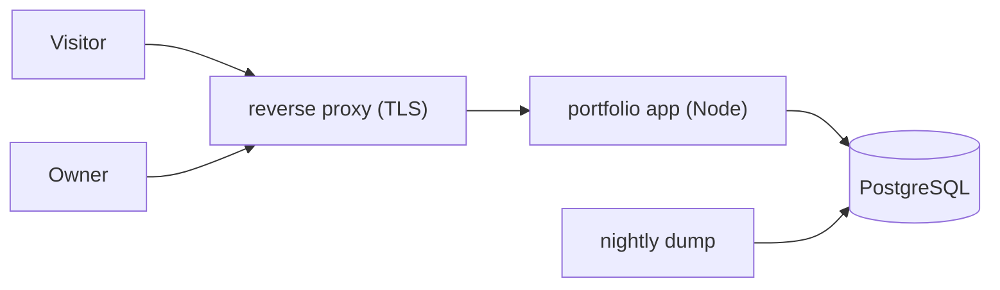
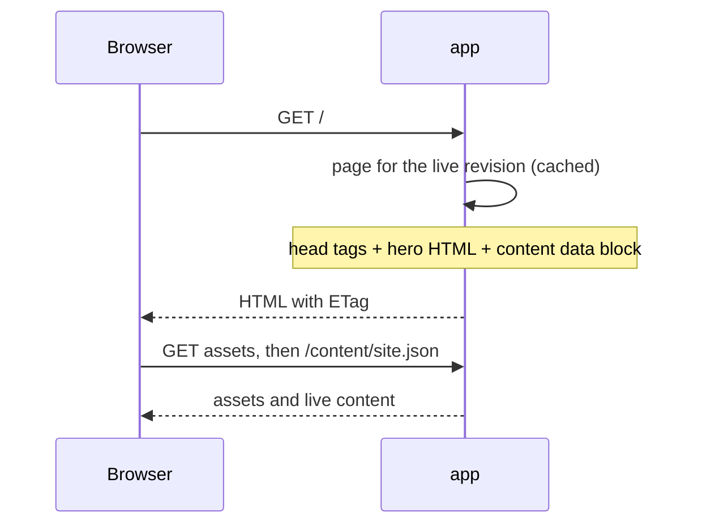

# portfolio: architecture

**Version:** 1.1  **Date:** 2026-11-26  **Status:** Built, not deployed
**Related:** [PRD](PRD.md), [Design](DESIGN.md), [Database](DATABASE.md), [API](API.md)

## 1. Overview

One Node process in one container serves the web app and the API. PostgreSQL holds users, sessions, content
revisions and the audit log. The target is a virtual server with Traefik in front for TLS. Local work uses SQLite.

## 2. Drivers

- The approved experience stays; admin edits need no rebuild.
- Read-only, stateless application container.
- Fast first paint on a slow phone.
- One owner and small traffic: simple beats scalable.

## 3. High-level architecture

Diagrams: [runtime](diagrams/runtime-architecture.html), [deployment and pipeline](diagrams/deployment.html)
(open the HTML files in a browser). The deployment shown is the target; it does not run anywhere yet.

### 3.1 Context

### 3.2 Containers

| Container | Role | Network | State |
|---|---|---|---|
| `app` | static files, server-rendered page, API | `web`, `portfolio-data` | none |
| `postgres` | database | `portfolio-data` (internal) | database volume |
| `pg-backup` | nightly dump | `portfolio-data` | backup volume |
| `pg-restore-test` | on demand: restores the newest dump into a throwaway server | `portfolio-data` | none |

### 3.3 Server modules (`server/`)

| File | Role |
|---|---|
| `index.mjs` | routes, response headers, start-up checks |
| `guard.mjs` | proxy trust, client address, Host, Origin and content type check |
| `auth.mjs` | passwords, sessions, known-browser token |
| `throttle.mjs` | sign-in limits (in memory) |
| `hash-gate.mjs` | cap on password hashing |
| `content.mjs` | validation, length limits, key order, revisions, live copy in memory |
| `shell.mjs` | builds the page for `/` once per revision |
| `head.mjs` | fills title, descriptions, structured data and the no-script note from the content |
| `static.mjs` | Brotli and gzip, ETag, cache rules, not-found |
| `db.mjs`, `db-pg.mjs`, `db-sqlite.mjs` | one interface, two drivers |

`server/` does not import from `src/`; code used by both lives in `shared/`.

## 4. Technology stack

| Layer | Choice |
|---|---|
| Web | React 19, TypeScript 5.9, Vite 8, Tailwind CSS 4, framer-motion, lenis |
| 3D | three, react-three-fiber, drei |
| Server | Node 26 in the image (`engines` 22.18 or newer), `node:http`, `pg` |
| Database | PostgreSQL 17; SQLite for local work and tests |
| Tests | `node:test` |
| Delivery | Docker, Docker Compose, Traefik, Jenkins, GitHub Actions |

Exact versions: `package-lock.json`.

## 5. Data

- The newest content revision that validates is the live content ([ADR 0002](adr/0002-content-in-database.md)).
- Save: check, insert one row, refresh the memory copy. Visitors read the copy.
- Personal data: the owner's public profile, the owner login, and IP addresses and browser strings in sessions and
  the audit log. [Database](DATABASE.md).

## 6. Request paths

### 6.1 Visitor opens `/` (production)

If building the page fails, the plain `index.html` is served and the build is tried again after 30 seconds
([ADR 0003](adr/0003-prerendered-hero-shell.md)). Its built-in head text then shows instead of the live one.
The head tags are filled only by the production server; the development web server shows the built-in ones.

### 6.2 Owner saves

`PUT /api/content`: request check, session and CSRF, validation and length limits, optional `baseRevision` check,
insert, refresh the live copy. [API](API.md).

## 7. Security

- Trust boundaries: internet to proxy; proxy to app (`TRUST_PROXY` hop count); app to database (internal network).
- One owner role. Details: [Authentication and security](implementation/Authentication-Security.md).
- No published container ports in the server stack.

## 8. Performance

| Item | Budget | Enforced by |
|---|---|---|
| LCP (profile in PRD NFR-001) | at or under 2500 ms | measured by hand |
| First-load JavaScript, gzip | at or under 160 kB | `scripts/check-bundle.mjs` |
| CSS, gzip | at or under 15 kB | `scripts/check-bundle.mjs` |
| 3D library in the first load | none | `scripts/check-bundle.mjs` |

Hashed assets are cached for a year, fonts for 30 days; pages and content use `no-cache` with ETag.

## 9. Failure behaviour

| Failure | Behaviour |
|---|---|
| Database drops while running | content keeps serving from memory; `/api/ready` answers 503; saving fails |
| Newest revision is invalid at start | the newest valid one is served and the admin warns; with none valid the app does not start |
| Page build fails | plain `index.html` |
| Live content not loadable in the browser | what is on screen stays |
| 3D or game file fails | error boundary and fallback; content stays |

## 10. Observability

Logs to standard output with rotation in the server stack; health `/api/health` and `/api/ready`; audit log table.
No metrics, tracing or alerting in release 1.

## 11. Deployment

Environments: local (SQLite) and production (not live). One container replaced per deploy, with the previous image
kept for rollback: a few seconds of downtime. Files: `deploy/compose.yaml`, `Jenkinsfile`,
[deploy guide](../deploy/README.md), [ADR 0004](adr/0004-deploy-hostinger-vps.md),
[ADR 0005](adr/0005-database-storage-and-backups.md).

## 12. Cross-cutting

- Configuration: environment variables ([README](../README.md#environment-variables)). Production refuses to start
  without a database, `TRUST_PROXY`, `PUBLIC_ORIGIN` and, on an empty database, `ADMIN_PASSWORD`.
- One replica only: the live content copy and sign-in limits are per process.
- Language: English only.

## 13. Testing and delivery checks

| Level | What |
|---|---|
| Unit and component | game logic, content validation, server-rendered page, layout rules |
| API black box | server and security tests on SQLite and PostgreSQL |
| Container | read-only, non-root start, ready, probe, password reset (gate 8) |
| Browser | manual and scripted checks outside the repository; no browser test package |
| Gates | `scripts/ci.sh`; GitHub workflows in `.github/workflows/` |

## Appendix: decisions

[0001 stack and layout](adr/0001-stack-and-repo-layout.md), [0002 content](adr/0002-content-in-database.md),
[0003 server-rendered hero](adr/0003-prerendered-hero-shell.md), [0004 deploy](adr/0004-deploy-hostinger-vps.md),
[0005 database and backups](adr/0005-database-storage-and-backups.md).
