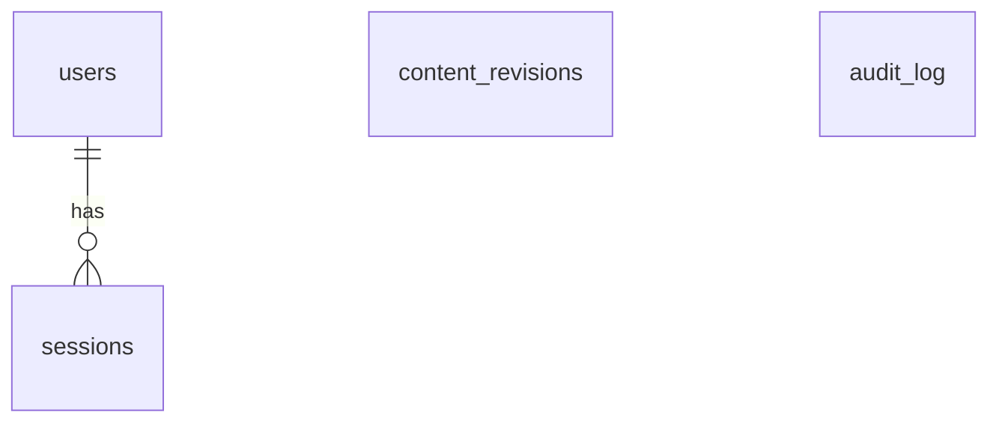

# portfolio: database

**Version:** 1.1  **Date:** 2026-11-26  **Status:** Built, not deployed
**Related:** [Architecture](ARCHITECTURE.md), [API](API.md)

## 1. Overview

PostgreSQL 17 in production through the `pg` pool (`PG_POOL_MAX`: default 10, the server stack sets 5). Built-in
SQLite for local work and tests. Both drivers share SQL with `?` placeholders. The table definitions are in
`server/db-pg.mjs` and `server/db-sqlite.mjs`.

## 2. Model

## 3. Schema (PostgreSQL)

| Table | Columns | Notes |
|---|---|---|
| `users` | `id serial PK`, `email text unique`, `name text`, `password_hash text`, `created_at timestamptz`, `last_login_at timestamptz` | the owner |
| `sessions` | `id text PK` (SHA-256 of the token), `user_id integer FK users on delete cascade`, `csrf text`, `created_at`, `expires_at`, `ip text`, `user_agent text` | 8 hour life; expired rows removed |
| `content_revisions` | `id serial PK`, `json text`, `note text`, `author text`, `created_at timestamptz` | newest valid `id` is live |
| `audit_log` | `id serial PK`, `at timestamptz`, `actor text`, `action text`, `detail text`, `ip text` | the app only adds rows (the `npm run db:check` probe removes its own) |

Indexes (PostgreSQL): `idx_sessions_user`, `idx_sessions_expires`, `idx_revisions_created`, `idx_audit_at`. SQLite
has `idx_sessions_user` and `idx_revisions_created`.

`content_revisions.json` is `text`, not `jsonb`, so key order is kept.

## 4. Content document

Shape: `src/content/types.ts`. Server rules: `validateContent` and `lengthProblems` in `server/content.mjs`.
Keys outside the schema are dropped on save.

| Part | Rules |
|---|---|
| `meta` (optional) | `description`, `shareDescription`: text; empty or absent keeps the built-in page tag |
| `profile` | name, initials, role, tagline, location, timezone, email (must look like one), availability: required; `socials[]` with `label` and `href` (`https://`, `mailto:`, `tel:` or a local `/` path, not `//`), `handle` text if present |
| `hero` | eyebrow, headline, subline, primaryCta, secondaryCta: required |
| `stats[]` | at least one; value and label required, suffix may be empty |
| `chapters[]` | at least one; unique `id` of lower-case letters, digits and dashes, not reserved; label, kicker, title, body, hint, at least one bullet; hex `accent` |
| `principles[]` | title and body |
| `contact` | heading, body, primaryLabel |
| `stack[]` | at least one; name, `icon` from the bundled list, `level` 0 to 100 |

### 4.1 Length limits

Checked **on save only**, so older revisions still start and restore.

| Characters | Fields |
|---|---|
| 8 | `profile.initials` |
| 9 | `chapters[].accent` |
| 20 | `stats[].suffix` |
| 40 | `stats[].value` |
| 120 | `profile.name`, `role`, `location`, `timezone`, `socials[].label`; `hero.eyebrow`, `primaryCta`, `secondaryCta`; `stats[].label`; `chapters[].id`, `label`, `kicker`, `hint`; `contact.primaryLabel`; `stack[].name` |
| 200 | `profile.availability`, `socials[].handle`; `hero.headline`; `chapters[].title`; `principles[].title`; `contact.heading` |
| 254 | `profile.email` |
| 500 | `profile.socials[].href` |
| 600 | `meta.description`, `meta.shareDescription`; `profile.tagline`; `hero.subline`; `chapters[].bullets[]`; `principles[].body`; `contact.body` |
| 2000 | `chapters[].body` |

## 5. Access patterns

| Pattern | Query |
|---|---|
| Start | newest revision by `id` descending that parses and validates (others are logged); seed if the table is empty; none valid stops the start |
| Save and restore | one insert |
| History | newest 30 by `id` descending, plus the first revision |
| Sign-in | session inserted from the user row only while the checked password hash is still stored (`FOR SHARE` on PostgreSQL) |
| Session check | by primary key, joined to the user |

Order by `id`, not `created_at`. Statements are limited to 10 seconds. No partitioning or views at this size.

## 6. Seed data

`content/site.json` is inserted as the first revision (note `seed`, author `system`) when the table is empty. The
owner account is created on the first start. A manual database edit needs an app restart.

## 7. Roles

| Role | Use |
|---|---|
| `portfolio_app` | owns database `portfolio`, not a superuser |
| `portfolio_backup` | read only; used by the dump and restore-test jobs with `BACKUP_DB_PASSWORD` |

Created by `deploy/postgres-init/10-app-role.sh` on the first start; safe to run again. Network sign-in needs a
password. The database health check proves readiness, not the password. The database sits on an internal network and
publishes no port. New volumes use data checksums.

## 8. Migrations

Release 1 changes no table: `CREATE ... IF NOT EXISTS` at start. The first `ALTER` brings numbered SQL files and a
version table.

## 9. Backup and restore

Nightly `pg_dump -Fc` and a dump before every deploy; nothing is deleted automatically (`BACKUP_PRUNE=0`). Restore
tests run into a throwaway server. Commands, failure signals and the live restore steps:
[deploy guide](../deploy/README.md#backup-and-restore). Dumps are on the same disk: a copy elsewhere is not set up.

## 10. Verification and gaps

Tests run on SQLite and on PostgreSQL ([Testing](implementation/Testing-QA-Debugging.md)). Dump and restore were
rehearsed locally with `deploy/rehearse.sh`. UNVERIFIED: the full live restore on a server, other processor
architectures, growth rate.
