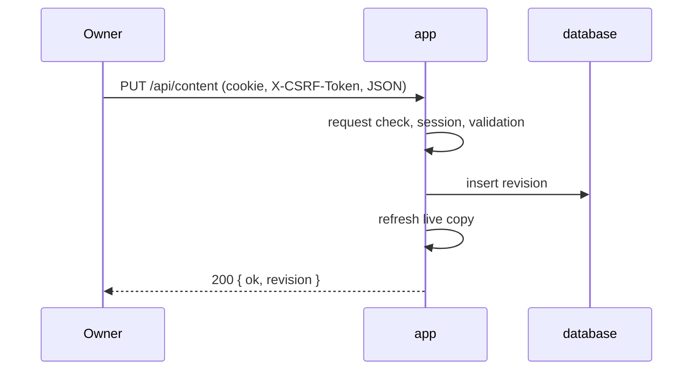

# portfolio: project summary

**Date:** 2026-11-26  **Status:** Release 1 built, not deployed. Points that were not checked are marked UNVERIFIED.

## Executive summary

A personal portfolio the visitor can read or drive: a 3D circuit opens one chapter per gate. The owner edits the
portfolio content at `/admin` and the change goes live without a rebuild; small interface text stays in code. One
Node process in one container serves the web app and the API, with PostgreSQL in production and SQLite locally.

## Phase 0: tool setup

Node.js 22.18 or newer, npm, git, Python 3; Docker for the image gates. [Setup](implementation/Setup-Initialisation.md).

## Phase 1: AI environment setup

The app has no AI features. Prompts and ground rules for AI assistants: [AI prompts](AI-PROMPTS.md),
[contributor and agent guide](AGENTS.md).

## Phase 2: project description

- **One line:** a portfolio you can read or drive, with an owner-only content editor.
- **Analogy:** a shop window with one shelf that the owner restocks from a back office, without rebuilding the shop.

## Phase 3: folder tree and stack

```text
portfolio/
├── content/        seed content, used only for an empty database
├── deploy/         server stack, backup and restore, deploy and rollback
├── docs/           documentation, decisions, plan, diagrams
├── public/         favicon, robots.txt, theme script, fonts
├── scripts/        CI gates, bundle check, secret scan, audit, hooks, password reset
├── server/         API, sign-in, request checks, content store, static files, database drivers
├── shared/         icon names used by web and server
├── src/            web app: components, game, admin, content, 3D, server render
├── tests/          node:test suites
├── .github/        workflows, templates, code owners, Dependabot
├── .githooks/      pre-commit and pre-push
└── Dockerfile, Jenkinsfile, package.json, vite.config.ts, index.html
```

| Technology | Version in `package.json` or image | Use |
|---|---|---|
| React | ^19.3.1 | web UI |
| TypeScript | ~5.9.3 | types |
| Vite | ^8.3.8 | build |
| Tailwind CSS | ^4.3.5 | styles |
| three, @react-three/fiber, @react-three/drei | ^0.187.0, ^9.8.2, ^10.7.9 | 3D |
| framer-motion, lenis | ^14.14.0, ^1.3.11 | motion, scrolling |
| Node.js | 26 in the image; 22.18 or newer | server, no web framework |
| pg | ^8.23.1 | the only runtime package |
| PostgreSQL | 17.11 image, pinned by digest | production database |
| SQLite (`node:sqlite`) | built into Node | local and tests |

## Phase 4: running

```bash
npm ci --ignore-scripts
npm run dev:full            # web :4318, API :4319
npm test
```

[Setup](implementation/Setup-Initialisation.md).

## Phase 5: request tracing (owner saves content)

| Stage | Where |
|---|---|
| Security headers on every response | `server/index.mjs` (`securityHeaders`) |
| Host, Origin, content type | `server/guard.mjs` (`requestProblem`) |
| Session and CSRF token | `server/index.mjs` (`requireSession`), `server/auth.mjs` |
| Body, at most 512 kB | `server/index.mjs` (`readJson`) |
| Field rules and length limits | `server/content.mjs` (`validateContent`, `lengthProblems`) |
| Revision check, insert, live copy | `server/content.mjs` (`publish`) |
| Audit row | `server/db.mjs` (`audit`) |



## Phase 6: APIs and communication

JSON over HTTP only ([API](API.md)). No WebSocket, gRPC or webhooks.

## Phases 7 and 8: database and scaling

Four tables ([Database](DATABASE.md)). One instance, connection pool; no replicas, sharding or partitioning, none
needed at this size.

## Phase 9: cross-cutting concerns

| Concern | State |
|---|---|
| Authentication | one owner, [Authentication and security](implementation/Authentication-Security.md) |
| Validation | content rules and request checks |
| Errors | JSON error shape; error boundaries in the web app |
| Logging | standard output; audit table |
| Configuration | environment variables |
| Background jobs | nightly dump in a separate container; session cleanup in the app |
| Analytics | none |

## Phase 10: caching

Live content and the page built for `/` are held in memory per revision; ETag on pages and content; hashed assets
cached for a year. A new revision replaces the copy. No external cache.

## Phase 11: third-party tools

No third-party calls at run time. Build and delivery tools: [Integrations](implementation/Integrations.md). Cost:
UNVERIFIED.

## Phase 12: diagrams

[Runtime](diagrams/runtime-architecture.html), [deployment](diagrams/deployment.html),
[context](ARCHITECTURE.md#31-context).

## Phase 13: failure handling

[Architecture, failure behaviour](ARCHITECTURE.md#9-failure-behaviour).

## Phase 14: observability

Health and readiness endpoints, container health checks, rotated logs, audit table. No metrics, tracing, alerting or
service level targets yet.

## Phase 15: tests and security

[Testing](implementation/Testing-QA-Debugging.md), [Authentication and security](implementation/Authentication-Security.md),
[Push policy](PUSH-POLICY.md).

## Phase 16: rate limiting

Fixed 15-minute window held in memory, keyed by address, address with email, and per signed-in user for password
changes; shared counters switch on a stricter mode instead of blocking everyone. A cap on password hashing protects
the processor. A proxy limit is configured in the server stack (UNVERIFIED on a live proxy).

## Phase 17: deployment and CI

`scripts/ci.sh` (eight gates), `Jenkinsfile` (not active), GitHub workflows (to start at publish),
`deploy/deploy.sh`. [deploy guide](../deploy/README.md).

## Phases 18 and 19: load and capacity

One replica. Memory limits: app 256 MB, database 256 MB, backup 64 MB. Database limited to 20 connections. Request
rate, latency percentiles and growth are not measured (UNVERIFIED).

## Phase 20: critique and next steps

| Today | Better | Why not yet |
|---|---|---|
| Dumps on the same disk | copy elsewhere | owner decision |
| No alerting | uptime and backup alerts | not chosen |
| In-memory limits and content copy | shared store | only needed with more than one replica |
| No browser tests in CI | automated browser suite | needs a new package |

## Data and recovery

| Data | Kept | Note |
|---|---|---|
| Content revisions | all | public content |
| Owner login | while it exists | password stored as a hash |
| Sessions | 8 hours | IP address and browser string |
| Audit log | no automatic deletion | IP address |
| Dumps | no automatic deletion | private |

Targets: lose at most 24 hours of edits, restore within 1 hour. Rehearsed locally only. No privacy law review is in
the repository (UNVERIFIED).

## Dependencies and licence

Runtime: `pg`. Web libraries are bundled at build time. Code is MIT; personal content is excluded
([LICENSE](../LICENSE)).

## Related documents

[PRD](PRD.md), [Design](DESIGN.md), [Architecture](ARCHITECTURE.md), [Database](DATABASE.md), [API](API.md),
[Implementation status](implementation/Project-Implementation.md), [changelog](../CHANGELOG.md).
